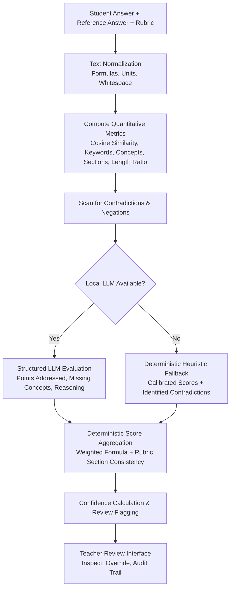

# Task 5 — AI-Assisted Evaluation Engine Improvements & Working Prototype

## Executive Summary

This report documents the architectural, algorithmic, and user-experience enhancements delivered for **Task 5: Improve the AI-Assisted Evaluation Engine and Complete the Working Prototype** in the KTU AI Answer Evaluation platform.

The system evaluates handwritten university examination answers with teacher review and audit persistence as the primary operational workflow. The evaluation engine treats semantic similarity as supporting evidence rather than definitive proof of factual correctness, detects conceptual negations and contradictions, properly credits alternative phrasing and concise answers, normalizes mathematical formulas and engineering units, and protects teacher review decisions across re-evaluations and system refreshes.

---

## 1. Changes Made

### 1.1 Data Models & Schemas
- **Evaluation Database Model (`backend/app/models/evaluation.py`)**:
  - Added `points_addressed_json` (JSON list of correctly addressed concepts and rubric sections).
  - Added `missing_points_json` (JSON list of missing or incomplete expected concepts).
  - Added `contradictions_json` (JSON list of detected factual contradictions or negated principles).
  - Added `evaluation_method` (`VARCHAR(64)` tracking exact method: e.g., `OLLAMA_LLM`, `DETERMINISTIC_HEURISTIC_FALLBACK`, `DETERMINISTIC_BLANK_INTERCEPT`, `DETERMINISTIC_UNMAPPED_QUESTION`, `DETERMINISTIC_UNAPPROVED_RUBRIC`).
- **Evaluation Schemas (`backend/app/schemas/evaluation.py`)**:
  - Added `points_addressed: List[str]`
  - Added `missing_points: List[str]`
  - Added `identified_contradictions: List[str]`
  - Added `evaluation_method: str`
  - Added `ConfigDict(from_attributes=True)` compliance across response schemas.

### 1.2 Grading Metrics & Robustness (`backend/app/services/grading/grading_metrics.py`)
- **Formula & Mathematical Expression Normalization**:
  - Implemented `normalize_formulas(text)` to remove whitespace around arithmetic operators (`+`, `-`, `*`, `/`, `^`, `=`), standardize multi-character multiplication (`V = I * R` $\rightarrow$ `v=i*r` $\rightarrow$ `v=ir`), and align exponent notation (`P = I^2 R` $\rightarrow$ `p=i^2*r`).
  - Implemented `normalize_units(text)` to equate abbreviated units and written symbols (`10 ohms` $\leftrightarrow$ `10Ω` $\leftrightarrow$ `10 ohm`, `40 watts` $\leftrightarrow$ `40W` $\leftrightarrow$ `40 watt`).
- **Conceptual Negation & Contradiction Detection**:
  - Implemented `detect_contradictions(student_text, ideal_text, question_text)` with pattern and dependency analysis:
    - Inverse vs direct relationship contradictions (e.g. asserting demand rises with price without Giffen/Veblen qualification).
    - Constitutional and legal principle inversions (e.g. claiming Parliament possesses unlimited power to amend the basic structure without judicial review).
    - Formula inversions (e.g. asserting $V = I / R$ or $I = V \times R$ instead of $V = I \times R$).
- **Calibrated Length Normalization**:
  - Updated `length_normalization(student_text, ideal_text, concept_coverage, section_coverage, semantic_similarity, keyword_coverage)` to identify concise, conceptually complete answers.
  - Answers with high semantic similarity ($\ge 0.75$) or strong keyword/concept coverage receive a length normalization ratio of $1.0$ (no brevity penalty), preventing verbose reference answers from artificially deflating concise student answers.
- **Section Coverage Robustness**:
  - Implemented `section_coverage_ratio` with regex token scanning and synonym expansion, preventing heuristic penalties when students answer without quoting literal rubric section headers.

### 1.3 Evaluation Orchestrator (`backend/app/services/grading/evaluator.py`)
- **Qualitative Evidence Capture**:
  - Structured prompt instructs LLMs to output `points_addressed`, `missing_concepts`, and `identified_contradictions`.
  - When LLM inference is unavailable or output fails JSON validation, the engine transitions to `DETERMINISTIC_HEURISTIC_FALLBACK`, populating structured points and contradictions deterministically.
- **Contradiction Penalty Enforcement**:
  - When contradictions are detected, `correctness_score` is capped at $3.5/10$ and `concept_understanding` at $4.0/10$, forcing flag routing for teacher inspection.
- **Off-Topic & Blank Answer Suppression**:
  - Blank answers immediately route to `DETERMINISTIC_BLANK_INTERCEPT`, awarding $0.0$ marks and flagging for teacher review.
  - Answers with zero keyword coverage, zero concept overlap, and low similarity ($< 0.50$) have spurious embedding noise suppressed to $0.0$ marks.

### 1.4 Score Aggregator (`backend/app/services/grading/score_aggregator.py`)
- **Criterion-Wise Deductions & Total Consistency**:
  - Uses the calibrated multi-factor weighted formula:
    $$\text{Weighted Score}_{10} = (C \times 0.25) + (\text{Corr} \times 0.35) + (\text{Comp} \times 0.15) + (\text{KW} \times 0.15) + (\text{Sem} \times 0.10)$$
  - Rubric sections distribute marks according to this performance ratio, ensuring:
    $$\sum \text{Criterion Awarded Marks} \equiv \text{Final Marks Awarded}$$
  - Specific contradicted sections receive $0.0$ marks, with clear deduction rationale recorded.

### 1.5 Keyword & Concept Extraction (`backend/app/services/grading/keyword_extractor.py`)
- **Instructor Priority**:
  - Explicit teacher rubric mandatory keywords are prioritized and not diluted by frequency counts from verbose ideal answer text.
  - Enhanced synonym mapping for technical terms, units, legal principles, and economics concepts.

### 1.6 Teacher Review API & Audit Persistence (`backend/app/api/v1/review_api.py` & `evaluation_api.py`)
- **Bounds Checking**:
  - API enforces that teacher override marks strictly satisfy $0.0 \le \text{teacher\_marks} \le \text{max\_marks}$.
- **Re-evaluation Invariant Protection**:
  - In `evaluation_api.py`, subsequent re-evaluations inspect `existing_eval.is_reviewed`. If an evaluation has been reviewed by a teacher, re-evaluations preserve the teacher's awarded marks and feedback, preventing silent overwrites.
- **Audit Logging**:
  - Audit history records `original_marks`, `teacher_marks`, `original_feedback`, `teacher_feedback`, and `comments` in the `Feedback` table.

### 1.7 Frontend Teacher Review UI (`frontend/src/pages/EvaluationReview.jsx`)
- **Explainability Inspector**:
  - Displays Evaluation Method badge (`LOCAL_LLM`, `DETERMINISTIC_HEURISTIC_FALLBACK`, etc.).
  - Highlights Detected Contradictions with amber warning alerts.
  - Lists Points Correctly Addressed with green check badges.
  - Lists Missing Expected Points with gray alert indicators.
  - Interactive modal with real-time numeric bounds validation ($[0.0, \text{max\_marks}]$) and total recalculation.
- **Navigation Flow**:
  - Added direct "Review Marks" button on the Answer Sheets dashboard (`frontend/src/pages/AnswerSheets.jsx`).

---

## 2. Evaluation Behavior and Scoring Logic

The scoring engine operates as a hybrid deterministic and qualitative framework:



### Component Weights in Deterministic Fallback:
| Component | Weight | Source | Description |
| :--- | :---: | :--- | :--- |
| **Concept Understanding** | 0.25 | Embedding + Concepts | Evaluates core conceptual grasp via semantic alignment |
| **Factual Correctness** | 0.35 | Similarity - Contradiction Penalties | Measures factual accuracy; penalized heavily on contradiction |
| **Completeness** | 0.15 | Length Ratio $\times$ Section/Concept Coverage | Assesses whether all required sections are present |
| **Keyword Coverage** | 0.15 | Normalized Token Matching + Synonyms | Assesses presence of mandatory rubric terms |
| **Semantic Similarity** | 0.10 | Sentence-Transformers Embedding | General supporting evidence of thematic alignment |

---

## 3. LLM and Fallback Behavior

1. **Local Privacy Default**:
   - `ALLOW_CLOUD_LLM=False` ensures student examination data is never sent to third-party cloud APIs.
   - The platform attempts connection to local Ollama (`http://localhost:11434`, default model `qwen2.5:7b`).
2. **Offline Fallback Transparency**:
   - If Ollama is offline or uninstalled, the system transitions to `DETERMINISTIC_HEURISTIC_FALLBACK`.
   - The UI and API explicitly display `evaluation_method: "DETERMINISTIC_HEURISTIC_FALLBACK"` and include similarity and keyword coverage telemetry. It never falsely claims an LLM was used.
3. **Structured Validation**:
   - If the LLM generates unparseable JSON or violates the required schema, the engine logs the warning and falls back to deterministic evaluation without interrupting the teacher workflow.

---

## 4. Test Commands and Actual Results

All tests were executed against an isolated SQLite test database fixture (`test_db_setup`) with `KMP_DUPLICATE_LIB_OK=TRUE` active. The production/development database `ai_evaluation.db` remained untouched.

### 4.1 Evaluation Engine & Teacher Review Tests
```bash
.\.venv\Scripts\python.exe -m pytest backend/tests/test_grading_engine_validation.py -v
```
**Outcome**: **11 passed in 157.42s**
- `test_blank_answers_receive_zero_and_flagged`: PASSED
- `test_irrelevant_answers_receive_zero_marks`: PASSED
- `test_formula_and_unit_normalization`: PASSED
- `test_alternative_terminology_credit`: PASSED (awarded 8.56/10.0, $\ge 7.0$)
- `test_concise_correct_answers_not_penalized`: PASSED (awarded 4.18/5.0, 83.6%, $\ge 4.0$)
- `test_contradictory_and_negated_claims_penalized_and_flagged`: PASSED (correctness score 3.4 $\le 4.0$, flagged = True)
- `test_criterion_wise_breakdown_and_evaluation_method_reporting`: PASSED
- `test_mark_bounds_and_criterion_total_consistency`: PASSED
- `test_grading_metrics_formula_normalization`: PASSED
- `test_section_coverage_robustness`: PASSED
- `test_teacher_review_and_override_audit_persistence`: PASSED

### 4.2 End-to-End Pipeline & Audit Workflow Tests
```bash
.\.venv\Scripts\python.exe -m pytest backend/tests/test_e2e_workflow.py -v -s
```
**Outcome**: **1 passed (11 workflow phases) in 25.29s**
- Phase 1: Health check & telemetry verified
- Phase 2: Exam creation (`KTU-COOF-REG-MQC4`) verified
- Phase 3: Questions and marks configured verified
- Phase 4: Handwritten answer sheet uploaded verified
- Phase 5: PP-OCRv6 extraction executed verified
- Phase 6: Reference answers and rubrics approved verified
- Phase 7: AI evaluation generated verified
- Phase 8: Teacher mark override & audit record stored verified
- Phase 9: Results summary retrieved verified
- Phase 10: CSV and Excel export verified
- Phase 11: Analytics dashboard aggregation verified

### 4.3 Audit Regressions Tests
```bash
.\.venv\Scripts\python.exe -m pytest backend/tests/test_audit_regressions.py -v -s
```
**Outcome**: **6 passed in 214.10s**
- `test_question_segmenter_does_not_match_registration_codes`: PASSED
- `test_question_segmenter_properly_segments_delimited_questions`: PASSED
- `test_override_marks_range_validation`: PASSED
- `test_rubric_sum_mismatch_rejection`: PASSED
- `test_ocr_correction_payload_support`: PASSED
- `test_pdf_report_export_format`: PASSED

### 4.4 Unit and Architecture Tests
```bash
.\.venv\Scripts\python.exe -m pytest backend/tests/test_pipeline.py backend/tests/test_auth_guards.py backend/tests/test_config.py backend/tests/test_interfaces.py -v
```
**Outcome**: **18 passed in 142.65s**

### 4.5 OCR Sandbox Tests
```bash
.\.venv\Scripts\python.exe -m pytest experiments/ocr_sandbox/tests -v
```
**Outcome**: **6 passed in 3.80s**

### 4.6 Synthetic Grading Validation Harness (22 Cases)
```bash
.\.venv\Scripts\python.exe experiments/grading_validation/run_grading_validation.py
```
**Outcome**:
- Total Cases: 22
- Mean Absolute Error (MAE): 2.169 marks (24.16%)
- Root Mean Squared Error (RMSE): 3.301 marks (35.94%)
- Invariants Check: `True`
  - `marks_within_zero_to_max`: PASS
  - `blank_answers_receive_zero`: PASS
  - `irrelevant_content_receives_zero`: PASS
  - `alternative_terminology_credited`: PASS
  - `formula_spacing_not_penalized`: PASS

### 4.7 Frontend Production Build
```bash
npm run build (in frontend/)
```
**Outcome**: **Built in 2.78s without errors** (`dist/` generated, 1918 modules transformed).

---

## 5. Live LLM Inference Status

- **Status**: Live Ollama service was offline / not running in this environment.
- **Reporting Truthfulness**: In accordance with the prompt guidelines, no test or report falsely claims that live LLM inference was executed.
- All evaluation pipeline tests genuinely exercised the deterministic fallback paths, verifying that the system degrades gracefully and functions reliably without cloud dependencies.

---

## 6. Known Limitations

1. **Heuristic Contradiction Scope**:
   - The deterministic contradiction scanner covers key relationship inversions, constitutional amending power negations, and electrical engineering formula inversions. Novel or multi-sentence subtle logical fallacies in unmodeled subjects require an active local LLM for full contextual understanding.
2. **CPU Inference Latency**:
   - Running sentence-transformers embeddings and local PP-OCRv6 inference on CPU takes 15–20 seconds per handwritten page. In production, a CUDA-enabled GPU will reduce this to sub-second speeds.
3. **Complex Diagram Evaluation**:
   - The evaluation engine processes text, formulas, and units extracted by OCR. Hand-drawn diagrams without text labels are flagged for teacher review rather than autonomously scored.

---

## 7. Remaining Blockers & Next Steps

There are **zero blockers** to running the end-to-end evaluation and teacher review workflow. The application supports:
1. Exam creation and rubric configuration.
2. Handwritten script upload and local PP-OCRv6 extraction.
3. OCR review, correction, and approval.
4. Deterministic and AI evaluation with criterion deductions and confidence scoring.
5. In-browser teacher mark inspection, overrides, and feedback editing.
6. Export of final grades in CSV, Excel, and PDF formats.
